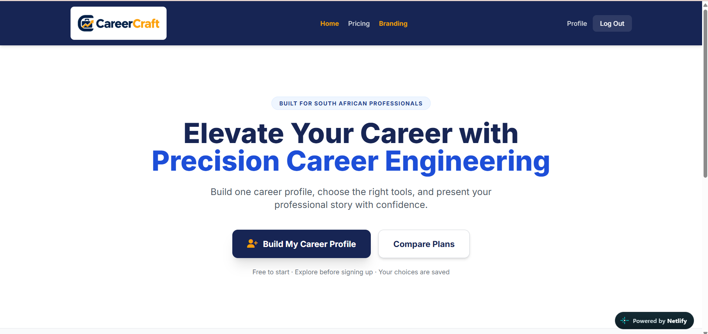
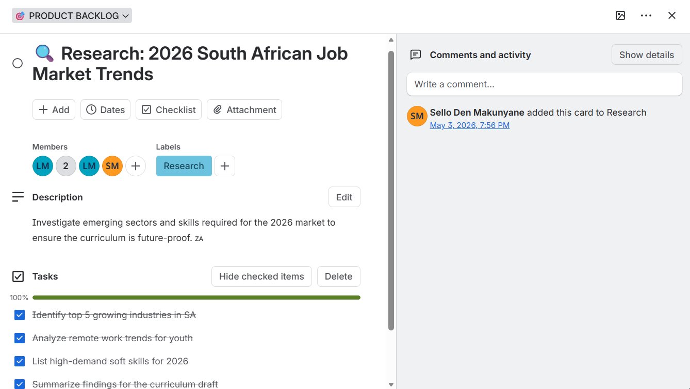
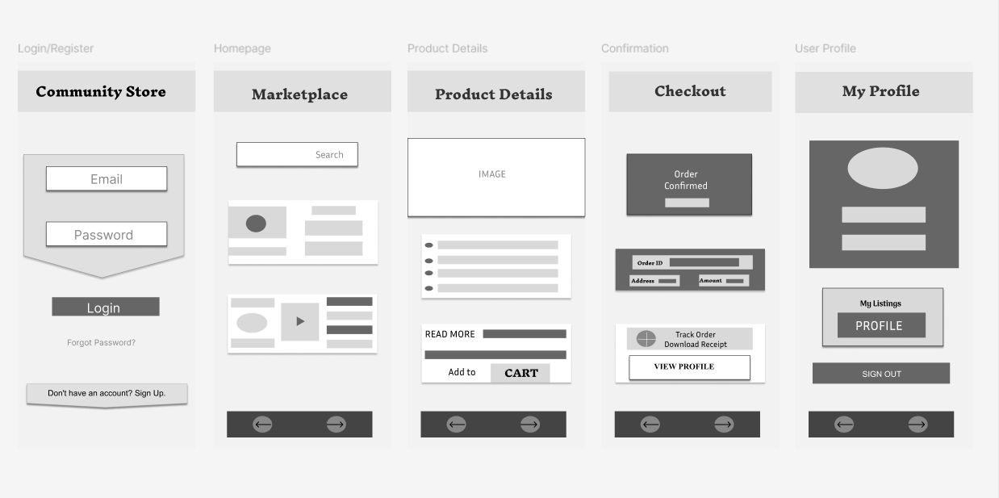
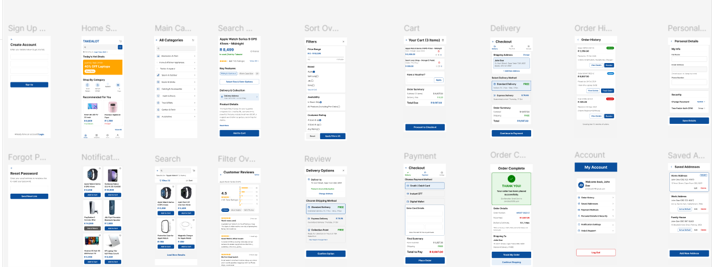
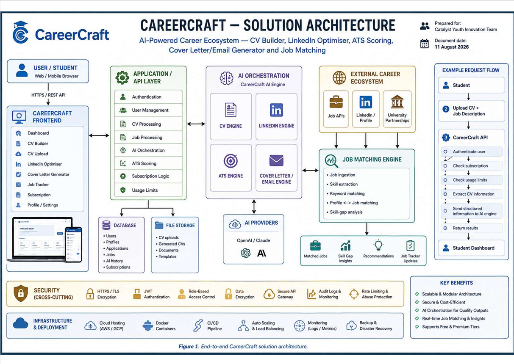
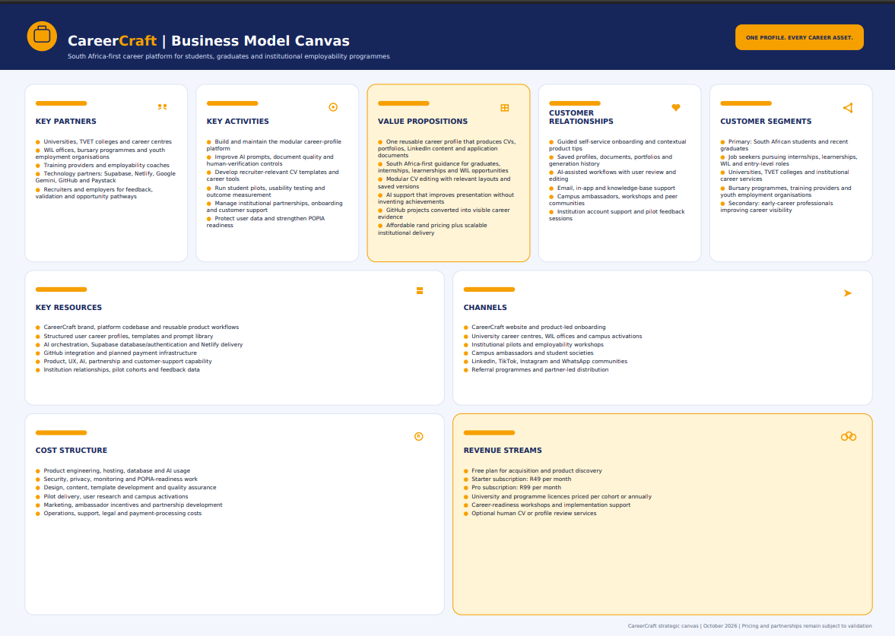

# 🚀 CareerCraft E-Portfolio 
> **Platform URL:** [careercraft-sa.netlify.app](https://careercraft-sa.netlify.app)  
> **Agile Lead:** Sello Den Makunyane  
> **Execution Period:** July 2026 – October 2026  
> **Repository Owner:** Sello007
# 🚀 CareerCraft SA — AI-Powered Career Engineering Portal

> 🌐 **Developer Hub:** [sello007.github.io](https://sello007.github.io/)  
> 🚀 **Live Application:** [careercraft-sa.netlify.app](https://careercraft-sa.netlify.app)  
> 👨‍💻 **Author / Agile Lead:** Sello Makunyane (CPUT - DPICTA / PRP370S)

---

## 🌟 Executive Summary & Project Introduction
Welcome to the official digital e-portfolio for **CareerCraft South Africa**, an all-in-one digital career engineering portal and AI-powered career ecosystem designed specifically to bridge the gap between academic graduation and professional employment for South African students and graduates. 

This repository documents our complete project lifecycle, adhering strictly to Agile/Scrum methodologies, software engineering best practices. CareerCraft is not merely a document generator; it is a full-suite career operating system that eliminates career evidence fragmentation, elevates candidate visibility with local Applicant Tracking Systems (ATS), and scales university career services.

---

## 📑 Table of Contents
1. [Problem Statement & Market Need](#1-problem-statement--market-need)
2. [Solution Architecture & Product Ecosystem](#2-solution-architecture--product-ecosystem)
3. [Agile Team Charter & Governance](#3-agile-team-charter--governance)
4. [User Stories and Task Breakdowns](#4-user-stories-and-task-breakdowns)
5. [Master Product Backlog](#5-master-product-backlog)
6. [Active Sprint Backlog & Iteration Planning](#6-active-sprint-backlog--iteration-planning)
7. [Business Model Canvas & Commercialization](#7-business-model-canvas--commercialization)
8. [Go-to-Market Strategy & Strategic Roadmap](#8-go-to-market-strategy--strategic-roadmap)
9. [Technology Stack, Infrastructure & Security](#9-technology-stack-infrastructure--security)
10. [Investment Ask & Fund Allocation](#10-investment-ask--fund-allocation)
11. [Agile Logbook (July – October 2026 Chronological Record)](#11-agile-logbook-july--october-2026-chronological-record)
12. [Evidence & Screenshots Gallery](#12-evidence--screenshots-gallery)

---

## 1. 🛑 Problem Statement & Market Need

South African university graduates and diploma holders face a severe structural barrier when attempting to transition from higher education into the formal labor market. Despite spending years acquiring rigorous theoretical knowledge, technical qualifications, and practical project competencies, thousands of qualified candidates are routinely filtered out of corporate recruitment pipelines before securing a single interview. The primary underlying cause of this transition failure is a profound document optimization and digital formatting disconnect: while modern employers and recruitment agencies rely almost exclusively on automated Applicant Tracking Systems (ATS) to screen incoming applications, graduate career documentation is traditionally produced in static, unoptimized Microsoft Word or PDF formats. Because these documents fail to adhere to automated technical parsing standards, lack localized industry-specific keyword optimization, and contain unreadable structural layouts, an estimated 50% to 65% of candidate resumes are rejected automatically by algorithms before a human recruiter ever evaluates the applicant's actual capability.

Furthermore, student career evidence remains deeply fragmented across isolated, disconnected platforms. A modern Information and Communication Technology (ICT) or engineering student generates rich professional artifacts across various ecosystems—maintaining code repositories on GitHub, managing task workflows on Trello, building professional networks on LinkedIn, and storing project documentation in local drives or cloud repositories. However, because there is no unified digital portal to synthesize these disparate signals into a single cohesive profile, candidates are forced to manually reconstruct their professional narratives from scratch for every single job application. This inefficient and repetitive process leads to severe application fatigue, inconsistent branding, and hastily formatted submissions that further diminish a candidate's chances of passing corporate ATS filters.

This structural bottleneck is further exacerbated by the severe economic and institutional environment within South Africa. The national youth unemployment rate consistently exceeds 45%, placing intense pressure on tertiary-educated youth to secure immediate employment upon graduation. While global AI-driven resume optimization and career management platforms exist to solve these document formatting challenges, their subscription structures are priced in foreign currencies ($15 to $30 USD per month). For South African students living on NSFAS bursary allowances, government stipends, or limited household budgets, these international platforms are financially prohibitive. Additionally, foreign tools lack localization for the South African labor context, failing to account for National Qualifications Framework (NQF) alignments, local industry terminology, and regional workplace expectations.

Finally, CareerCraft development centers across South African public higher education institutions face critical administrative capacity constraints. Small career advisory teams are tasked with serving tens of thousands of enrolled students across multiple campuses. Due to the sheer volume of manual resume reviews and walk-in consultations required daily, institutional career centers cannot offer personalized, real-time, iterative document feedback or AI-driven optimization at campus scale. As a result, South African graduates are left without an accessible, automated, or affordable mechanism to translate their academic qualifications and practical achievements into ATS-compliant, job-ready career documentation, leaving high-potential talent structurally invisible in an increasingly competitive national labor market.

### 📊 Key Market Pain Points:
* **The Youth Employment Crisis:** South Africa suffers from a youth unemployment rate exceeding 45%, leaving nearly half of qualified young South Africans unable to secure employment.
* **The ATS Filtering Barrier:** Over 60% of job application CVs are filtered out by automated Applicant Tracking Systems (ATS) before a human recruiter ever sees them due to poor formatting and lack of local keyword optimization.
* **Fragmented Career Signals:** Student career evidence exists in disconnected silos-CV files on local drives, LinkedIn profiles, GitHub repositories, and AI chat logs-forcing candidates to rebuild their narrative from scratch for every application.
* **Institutional Administrative Overload:** University career centers absorb immense manual labor guiding thousands of students through repetitive CV correction cycles without scalable digital platforms.

---

## 2. 💡 Solution Architecture & Product Ecosystem

### Strategic Solution Overview
CareerCraft solves the systemic graduate employability bottleneck by introducing a centralized, AI-orchestrated career engineering ecosystem designed explicitly for the South African labor market. Rather than forcing candidates to manually draft, format, and adapt isolated resume files for every job opening, CareerCraft introduces a single, verified, reusable digital career profile. Students aggregate their complete academic credentials, technical skills, practical project portfolios, and workplace competencies into one structured repository. Once established, the platform's intelligent engine automatically orchestrates, parses, and generates recruiter-ready, ATS-compliant application assets in seconds.

At the core of the CareerCraft ecosystem is an advanced AI prompt orchestration layer paired with automated parsing algorithms that analyze real-time job specifications against the student’s centralized profile. The platform evaluates keyword density, aligns candidate achievements with local South African industry standards (including NQF frameworks), and outputs tailored CVs, customized cover letters, and optimized LinkedIn profiles designed specifically to bypass corporate Applicant Tracking Systems. By eliminating complex formatting errors, unreadable visual elements, and missing key phrases, CareerCraft ensures that student documentation achieves maximum technical visibility when evaluated by automated corporate HR software.

Furthermore, CareerCraft bridges the financial accessibility gap by offering a localized, student-centric freemium model alongside an affordable R49 per month premium subscription. Designed specifically for South African tertiary students and young professionals reliant on NSFAS bursary allowances or limited budgets, CareerCraft provides enterprise-grade AI career tooling at a fraction of the cost of international platforms. By combining scalable continuous deployment hosted on Netlify with an intuitive web portal, CareerCraft empowers job seekers to continuously update their career evidence, eliminate application fatigue, and present their qualifications with absolute confidence.

### 🛠️ Core Modules:
1. **My CV & AI Document Studio:** Instantly scans, scores, and rewrites CVs against local job descriptions using AI orchestration (OpenAI / Claude / Gemini).
2. **LinkedIn & GitHub Portfolio Optimizer:** Optimizes headline keywords and embeds live developer project portfolios.
3. **ATS Engine:** Benchmark scoring with real-time feedback, gap analysis, and tailored rewrites.
4. **Job Tracker & Dashboard:** Enables real-time application tracking, status reminders, and performance analytics.

---

## 3. 🤝 Agile Team Charter & Governance

### 🎯 Team Mission & Vision
* **Vision Statement:** Bridge the experience and employment gap for South African graduates by providing an integrated, AI-driven career engineering suite.
* **Mission:** Deliver a mobile-optimized, secure web portal that simplifies career document creation, provides transparent Rand (ZAR) pricing, and connects graduates directly to opportunities.

### ⚖️ Working Agreements & Core Values
1. **Daily Stand-ups:** Synchronize daily at 09:00 for 15 minutes (Tasks completed, planned work, blockers).
2. **Radical Transparency:** Shared Trello product backlogs, open repositories, and early risk escalation.
3. **Quality & Definition of Done (DoD):** CV templates and AI prompts must be ATS-compatible, documented, ZAR-priced, and accepted by the Product Owner.
4. **Response Expectations:** 4-hour response window during core business hours via Teams and WhatsApp.

### 👥 Personnel Roles & RACI Matrix

| Project Task | Product Owner (Livhuwani) | Agile Lead (Sello) | Developer / Analyst (Lwandile) | QA / Liaison (Lerato) |
| :--- | :--- | :--- | :--- | :--- |
| **Project Vision & Charter** | A / R | C | C | I |
| **UI/UX Design & Brand Guidelines** | A | C | R | C |
| **Frontend & API Integration** | A | C | R | C |
| **Investor Pitch & Presentation** | A | C | R | C |
| **Usability Testing & Campus Pilots** | A | C | I | R |

*(Role Legend: A = Accountable, R = Responsible, C = Consulted, I = Informed)*

---

## 4. 📝 User Stories and Task Breakdowns

### 📋 Epic 1: Core Portal Architecture & Hosting Setup
* **User Story 1.1:** As a job-seeking graduate, I want to land on a fast, responsive homepage so that I can easily understand CareerCraft's ATS optimization value.
  * **Acceptance Criteria:** Page load < 2 seconds; bright accessible design scheme; clear CTA for free ATS check.
  * **Tasks:**
    * Design responsive Tailwind CSS layouts.
    * Deploy continuous deployment pipeline on Netlify (`careercraft-sa.netlify.app`).
    * Integrate functional GitHub repository links and official brand logo.

* **User Story 1.2:** As a registered user, I want to upload my CV and job description to receive an immediate ATS score and rewrite suggestions.
  * **Acceptance Criteria:** Real-time scoring out of 100 with skill-gap keyword highlights.
  * **Tasks:**
    * Build file upload dropzones supporting PDF/DOCX formats.
    * Establish API layer connection to AI orchestration engine.

---

## 5. 📊 Master Product Backlog

| Backlog ID | Feature / Epic Description | Priority | Status | Story Points | Target Milestone | Owner |
| :--- | :--- | :--- | :--- | :--- | :--- | :--- |
| **PB-01** | Landing page responsive design & Netlify deployment | High | Completed | 5 | July 2026 | Sello |
| **PB-02** | Investor pitch deck & business plan formulation | High | Completed | 5 | Mid-July 2026 | Lwandile / Livhuwani |
| **PB-03** | UI Prototyping & accessible light-mode redesign in Figma | High | Completed | 8 | Late-July 2026 | Sello / Lerato |
| **PB-04** | Brand Identity Guidelines & Logo Design | Medium | Completed | 3 | Early-August 2026 | Lerato |
| **PB-05** | Free Tier onboarding & subscription logic integration | High | Completed | 5 | Mid-August 2026 | Sello |
| **PB-06** | AI Engine & ATS Scoring API Integration | High | In Progress | 13 | September 2026 | Lwandile |
| **PB-07** | Student Cohort Usability Pilots (30–50 students) | Medium | In Progress | 8 | Late-September 2026 | Lerato |
| **PB-08** | Institutional Partner Admin Dashboard Integration | Low | To Do | 8 | Post-October 2026 | Livhuwani |

---

## 6. 🏃‍♂️ Active Sprint Backlog & Iteration Planning

* **Sprint Goal:** Finalize profile state persistence, complete ATS scoring verification, and refine brand guidelines.
* **Sprint Cycle:** Sprint 6 (2-Week Cycle)

| Task ID | Task Description | Assignee | Status | Effort Estimate |
| :--- | :--- | :--- | :--- | :--- |
| **T-201** | Refine `/profile` form input state handling and error alerts | Lwandile | In Progress | 3 pts |
| **T-202** | Conduct cross-browser session persistence tests | Lerato | To Do | 2 pts |
| **T-203** | Aggregate feedback from campus pilot testing | Lerato | Completed | 5 pts |
| **T-204** | Audit Netlify deployment security and CORS headers | Sello | Completed | 1 pt |
| **T-205** | Finalize database schema for CV template export module | Lwandile | To Do | 5 pts |

---

## 7. 💼 Business Model Canvas & Commercialization

### 🧩 Business Model Canvas Breakdown
* **Key Partners:** OpenAI / Anthropic API providers, University Career Services, SRCs, Campus Ambassadors, Cloud Hosting (AWS/Netlify).
* **Value Proposition:** Full-suite, SA-localized AI career tools (CV + LinkedIn + Cover Letter) delivering ATS-optimized assets in under 5 minutes at R49/month.
* **Customer Segments:** Primary: SA university students (~1.02M); Secondary: Recent graduates (0–2 yrs, ~563K); Tertiary: University career centers.
* **Revenue Streams:**
  * **Free Tier:** R0 (Basic ATS check, 1 optimization/mo).
  * **Premium B2C:** R49/month (Unlimited optimizations, cover letters, LinkedIn rewrites).
  * **Pro Tier:** R99/month (GitHub portfolio tools, personal branding, priority matching).
  * **B2B Enterprise:** Campus-wide licensing contracts for university career portals.

---

## 8. 📈 Go-to-Market Strategy & Strategic Roadmap

* **Campus Ambassador Network:** Deploying student influencers across 3–5 university campuses to drive organic word-of-mouth adoption via WhatsApp groups and TikTok CV transformations.
* **Institutional Partnerships:** Partnering directly with university career centers to embed CareerCraft into graduate readiness modules.
* **Target Reach:** 50,000 graduates employed by 2030.

---

## 9. 🛡️ Technology Stack, Infrastructure & Security

* **Frontend:** React, HTML5, Tailwind CSS, hosted on Netlify continuous deployment.
* **Backend & API Layer:** REST API, Node.js, Cloud Hosting (AWS / GCP / Netlify Functions).
* **Database & File Storage:** Supabase (PostgreSQL with Row-Level Security), AWS S3 for secure CV uploads.
* **AI Orchestration:** OpenAI API / Claude / Google Gemini integration for prompt engineering and ATS analysis.
* **Security & Compliance:** HTTPS/TLS encryption, JWT authentication, Role-Based Access Control (RBAC), and full compliance with the South African Protection of Personal Information Act (POPIA).

---

## 10. 💰 Investment Ask & Fund Allocation

CareerCraft is seeking **R500,000 in Seed Funding** to scale from a validated MVP into a nationally distributed career ecosystem across South Africa.

### 💵 Seed Capital Allocation:
* **35%** – Engineering, Security Infrastructure & AI API Scaling
* **25%** – Campus Pilots & User Research
* **20%** – Go-To-Market, Marketing & Campus Ambassadors
* **10%** – Operations, Legal & POPIA Compliance
* **10%** – Contingency Reserve

---

## 11. 📖 Agile Logbook 

### 🗓️ Phase 1: Pitch Deck & Deliverable Push 
Facilitated sprint planning; reviewed 16-slide investor deck structure with Livhuwani; assigned presentation section ownership. *Impediment:* Lacked slide design skills; consulted a senior 4th-year IT student for design guidance.

Delivered investor pitch to panel at 14:30 (presented by Lwandile with team support). *Impediment:* Home network instability forced team to use campus IT labs.
Analyzed panel feedback; initiated research on South African youth unemployment metrics. *Impediment:* Research paywalls slowed data verification.

Consolidated research notes for Deliverable 2; conducted retrospective on pitch delivery.

### 🗓️ Phase 2: Backlog Refinement & Trello Setup 
Met with Livhuwani, Lerato, and Lwandile to refine Trello backlogs based on lecturer feedback. Reorganized user stories, updated task priorities, and confirmed ownership assignments across the team.

### 🗓️ Phase 3: Prototyping & Accessible Redesign 
Presented initial dark-themed Figma prototype to lecturer. Received feedback that contrast was too dark and hard to read.

Overhauled UI palette to a bright, accessible color scheme. Designed official brand logo, added Free Tier section, updated GitHub linkages, and authored comprehensive Brand Guidelines.

### 🗓️ Phase 4: Functional Web App Deployment & Netlify Integration

Successfully transitioned CareerCraft from static Figma designs to a fully functional, live Web Application hosted on Netlify (`careercraft-sa.netlify.app`). 

Integrated core frontend navigation, responsive CTA hero sections ("Build My Career Profile", "Compare Plans"), dynamic branding tokens, and verified live cross-device accessibility. Configured Netlify continuous deployment pipelines linked directly to the primary GitHub repository branch to support real-time iterative updates.

---

## 12. 📸 Evidence & Screenshots Gallery

**Figure 12.1:** Live CareerCraft Netlify Web Portal Landing Page (`careercraft-sa.netlify.app`)  
  
*Showcases the live frontend user interface powered by Netlify, highlighting core CTAs ("Build My Career Profile", "Compare Plans") and responsive navigation.*

**Figure 12.2:** Trello Product Backlog Management & Research Card  
  
*Demonstrates agile backlog grooming, task checklists, and research card management for South African job market trends.*

**Figure 12.3:** Low-Fidelity UI Wireframes  
  
*Structural wireframe planning for user onboarding, profile setup, marketplace/portal navigation, and account settings.*

**Figure 12.4:** High-Fidelity Mobile UI App Flow  
  
*Comprehensive mobile user interface design flow detailing sign-up, search, catalog filtering, cart, delivery, and checkout workflows.*

**Figure 12.5:** End-to-End Solution Architecture Diagram  
  
*Details the technical architecture, AI orchestration layer (OpenAI/Anthropic integration), job matching engine, and cross-cutting security layers.*

**Figure 12.6:** Business Model Canvas Strategy  
  
*Outlines CareerCraft's core value propositions, South African market customer segments, cost structures, and sustainable R49/month revenue streams.*

---
*© 2026 CareerCraft South Africa & Catalyst Youth Innovation Team.*
